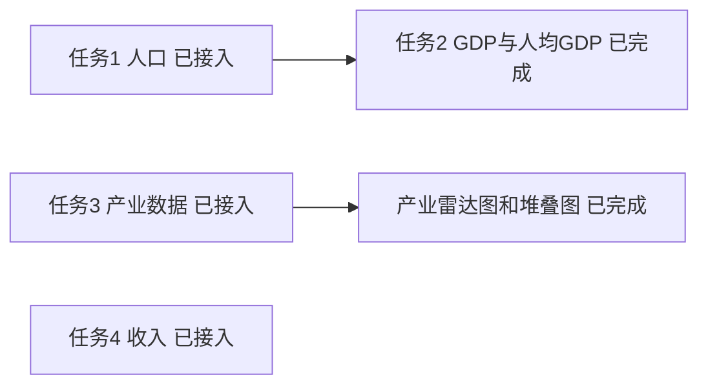
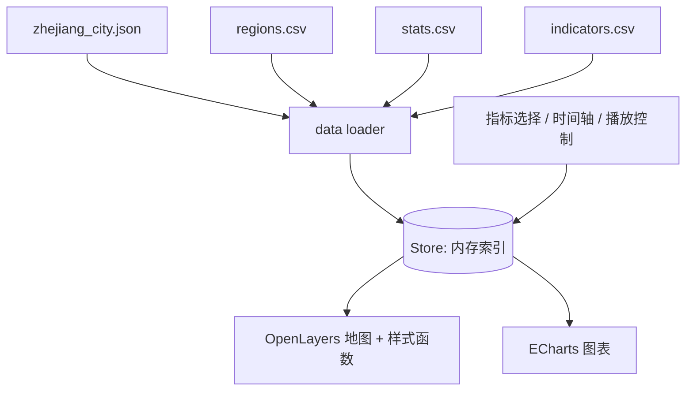

# 浙江省统计专题地图 WebGIS:项目设计文档(v0.2)

> 当前数据状态(2026-10-27)：任务 2 格式修订后已按提交原值接入；按用户要求忽略数值及统计口径问题。当前共 11 项指标、1210 条，覆盖 11 市、2016–2025 年。M3 已完成：GDP/人均 GDP 复用指标切换、跨年份固定分级、图例、时间轴、城市排行和历年趋势；以下历史修订中的等待状态已解除。详见 [数据接入记录](data_sources.md)。

> 初版修订说明(相对 v0.1):行政区划限定到市级;初版聚焦任务 1;`pop_density` 采用预计算方案;时间轴支持滑块拖动与自动播放;图表使用 ECharts。初版将任务 2~4 设为待办，最新状态见以上数据状态与以下修订。

> 界面修订(2026-10-26):地图铺满视口，控制面板、图例、时间轴和图表使用悬浮窗口；精简说明文案，保留操作标签与必要状态反馈。课设侧重可视化展示，省去数据口径提示和独立数据说明窗口。

> 数据修订(2026-10-26):用户提供任务 3、4 数据后，接入产业结构与收入，共 9 项指标、990 条记录。沿用本文的长表、冻结指标名、预计算方案、Store 与现有交互。来源及校验记录见 [数据接入记录](data_sources.md)。

> M4 修订(2026-10-26):使用现有任务 3 数据完成产业占比雷达图和产业增加值堆叠图。M3 暂停，等待任务 2 GDP/人均 GDP 数据，不从三次产业合计新增任务 2 指标。

> 图表联动修订(2026-10-27):所有“新建图表”窗口保留创建时的指标；城市范围与年份均跟随共享状态实时更新，清空城市选择时恢复全省 11 市。趋势图保留完整序列并移动当前年份虚线。此约定替代历史的城市范围及年份冻结约定。

> 交付状态(2026-10-27):用户已完成浏览器交互验收。加载优化将图表按类型动态加载，共享模块与所选类型并行请求；自动化测试及构建检查用于验证后续修改。

## 1. 项目概述

- **目标**:浙江省 11 个地级市的统计专题地图,支持指标切换、时间轴和图表联动。
- **范围**:行政区划**仅到市级**(1 个省 + 11 个地级市),不做县区级下钻,不引入县级 GeoJSON 与县级数据。
- **技术栈**:OpenLayers + Vite + ECharts。静态文件方案(GeoJSON + CSV),无后端。
- **当前实现范围**:任务 1 人口与密度、任务 2 GDP/人均 GDP、任务 3 产业结构及雷达图/堆叠图、任务 4 收入，M0–M5 已完成。

## 2. 任务状态

| 任务 | 内容 | 指标 | 状态 |
|---|---|---|---|
| 1 | 人口与密度 | `pop_resident`、`area_land`、`pop_density` | ✅ 已接入 |
| 2 | GDP 与人均 GDP | `gdp`、`gdp_per_capita` | ✅ 数据、地图、排行/趋势与时间轴联动已完成 |
| 3 | 产业结构 | `gdp_primary/secondary/tertiary`、`share_*` | ✅ 数据、地图、排行/趋势、产业雷达图/堆叠图已完成 |
| 4 | 收入 | `income_urban_pc` | ✅ 已接入 |



## 3. 数据现状(任务 1–4)

| 文件 | 状态 | 内容 |
|---|---|---|
| `regions.csv` | ✅ | 12 行:1 省 + 11 市,含 `area_land` 与中心点 |
| `stats.csv` | ✅ 任务 1–4 | 11 市 × 2016–2025 × 11 指标 = 1210 行 |
| `indicators.csv` | ✅ 已建(11 项) | 人口、经济、产业结构、收入指标元数据 |
| `geo/zhejiang_city.json` | ✅ 已规范化 | 浙江省 11 市边界 |

数据特征:

- `pop_density = pop_resident × 10000 / area_land`,已抽查杭州、舟山 2016 年与文件一致。
- 省级行(330000)无 `area_land`,`stats` 无省级数据。
- 年份范围为 2016–2025。
- `share_x = gdp_x / (gdp_primary + gdp_secondary + gdp_tertiary) × 100`，使用提交的预计算占比；任务 3 不依赖任务 2 的独立 GDP 数据。

## 4. 数据结构规范

### 4.1 目录

```
public/data/
├─ geo/zhejiang_city.json
├─ regions.csv
├─ stats.csv              # 任务 1–4 统一长表
├─ indicators.csv
└─ raw/                   # stats_task1.csv 至 stats_task4.csv
```

### 4.2 `regions.csv`

字段:`adcode, name, short_name, level, parent, area_land, center_lng, center_lat`

- `adcode` 为 6 位字符串,解析时禁止类型推断,须与 GeoJSON 的 `adcode` 类型一致。
- `level` 当前仅 `province | city`。
- `area_land` 单位 km²,静态值。

### 4.3 `stats.csv`(长表)

字段:`adcode, year, indicator, value`

- 每行一个地区、一年、一个指标;主键 `(adcode, year, indicator)`。
- `value` 只放数值,缺失行不写,不用 0 或占位符。
- 单位与口径放在 `indicators.csv`。

### 4.4 指标字典

当前启用:

| indicator | 中文名 | 单位 | 类型 | 存放位置 |
|---|---|---|---|---|
| `pop_resident` | 常住人口 | 万人 | 原始 | stats.csv |
| `pop_density` | 人口密度 | 人/km² | 派生(**预计算**) | stats.csv |
| `area_land` | 行政区面积 | km² | 原始(静态) | regions.csv |
| `gdp_primary` / `gdp_secondary` / `gdp_tertiary` | 一/二/三产业增加值 | 亿元 | 原始 | stats.csv |
| `share_primary` / `share_secondary` / `share_tertiary` | 一/二/三产业占比 | % | 派生(**预计算**) | stats.csv |
| `income_urban_pc` | 城镇居民人均可支配收入 | 元 | 原始 | stats.csv |

任务 2 已启用(命名保持冻结):

| indicator | 中文名 | 单位 | 类型 | 任务 |
|---|---|---|---|---|
| `gdp` | 地区生产总值 | 亿元 | 原始 | 2 |
| `gdp_per_capita` | 人均 GDP | 元/人 | 派生/官方 | 2 |

命名规则:前缀表示类别(`pop_`、`gdp_`、`share_`、`income_`),`_pc` 表示人均;指标名确定后不再更改。

### 4.5 派生指标决策:预计算

- 前端**不计算**派生指标,只读取 `stats.csv` 中的预计算值。
- 构建脚本做一致性校验:`|pop_density − pop_resident×10000/area_land| ≤ 0.1`,超限则报错。
- `gdp_per_capita` 和 `share_*` 均直接读取预计算值；按用户约定，任务 2 不校验人均 GDP 公式，也不校验 GDP 与产业合计的一致性。
- 当前产业占比的单项公式误差及三项合计偏离 100% 均允许 ≤ 0.01 个百分点；须有同一市年的全部三项增加值和占比，增加值合计须大于零。

### 4.6 `indicators.csv`(当前内容)

```csv
indicator,label,unit,decimals,category,type,formula,source,direction,note
pop_resident,常住人口,万人,1,人口,raw,,统计年鉴,neutral,
pop_density,人口密度,人/km²,1,人口,derived,pop_resident*10000/area_land,预计算,neutral,
gdp_primary,第一产业增加值,亿元,2,产业结构,raw,,各市统计局年度初步核算数,neutral,详见 docs/data_sources.md
gdp_secondary,第二产业增加值,亿元,2,产业结构,raw,,各市统计局年度初步核算数,neutral,详见 docs/data_sources.md
gdp_tertiary,第三产业增加值,亿元,2,产业结构,raw,,各市统计局年度初步核算数,neutral,详见 docs/data_sources.md
share_primary,第一产业占比,%,2,产业结构,derived,gdp_primary/(gdp_primary+gdp_secondary+gdp_tertiary)*100,预计算,neutral,以三次产业增加值之和为分母
share_secondary,第二产业占比,%,2,产业结构,derived,gdp_secondary/(gdp_primary+gdp_secondary+gdp_tertiary)*100,预计算,neutral,以三次产业增加值之和为分母
share_tertiary,第三产业占比,%,2,产业结构,derived,gdp_tertiary/(gdp_primary+gdp_secondary+gdp_tertiary)*100,预计算,neutral,以三次产业增加值之和为分母
income_urban_pc,城镇居民人均可支配收入,元,0,收入,raw,,任务4提交文件（未附来源说明）,positive,原始城市名称按地区表映射为行政区编码
gdp,地区生产总值,亿元,2,经济,raw,,任务2提交文件（未附来源说明）,positive,按用户要求原值接入，未核验数值及与产业合计的一致性
gdp_per_capita,人均 GDP,元/人,2,经济,derived,gdp*10000/pop_resident,任务2预计算提交值,positive,直接读取提交值，不重算；本次不校验计算一致性
```

## 5. 系统设计



### 5.1 内存索引

```js
// stats: Map<indicator, Map<year, Map<adcode, number>>>
const getValue = (ind, year, code) =>
  stats.get(ind)?.get(year)?.get(code) ?? null;
```

### 5.2 地图

- 市级面图层按当前指标与年份分级设色(choropleth)。
- 切换年份/指标仅调用 `layer.changed()`,不重新读取 GeoJSON。
- 分级断点按指标在**所有年份**的数据统一计算(分位数或自然断点)并固定,保证不同年份颜色含义一致。
- `getValue` 返回 `null` 时显示灰色"无数据"。
- 点击市级要素:高亮并联动图表;不做县级下钻。
- 地图覆盖整个浏览器视口，窗口不占用文档流；空白区域可直接平移、缩放和选择城市。工具栏可返回全省、重新打开控件或关闭全部窗口，不默认展示数据表。
- 控制面板的城市按钮提供键盘多选入口和当前指标数值提示，代替原有表格选择；共享状态仍包含当前指标、年份和城市选择。

### 5.3 时间轴

- 默认:滑块拖动选择年份(范围由 `stats` 中的年份动态得出,当前 2016–2025)。
- 自动播放:播放/暂停按钮,逐年前进,到末年后循环或停止(默认停止,可配置);播放间隔默认 1000 ms,可调。
- 播放状态机:`paused ⇄ playing`;用户拖动滑块时自动转为 `paused`。
- 播放时使用固定断点,避免颜色闪烁。
- 时间轴为独立悬浮窗口，关闭时暂停播放并取消控件订阅；重新打开后使用当前共享年份。

### 5.4 图表(ECharts)

当前(任务 1–4)实现:

- **环形饼图**:各市常住人口构成，占比以本次城市范围内有效人口合计为分母；人口密度不可相加，不提供密度占比。
- **横向条形排行图**:按时间轴当前年份和创建时指标降序排列城市数值，保留零值，缺失值不参与排名。
- **折线图**:城市指标随年份变化,可多城市对比；使用 `markLine` 标出时间轴当前年份，随时间轴移动，保留完整序列与缺失断点。
- 排行和趋势图支持全部 11 项已登记指标，按指标字典显示亿元、百分比或元等单位与精度。

- **产业占比雷达图**(M4):同一市年三个 `share_*` 作为三个坐标轴，按全部年份实际占比取整到 5% 作为各轴固定范围（三项占比量级差异大，0 至 100% 会挤成一团），直接读取预计算值，不归一化。采用每市一个小雷达的小多图，统一蓝色，底部注明坐标范围。
- **产业增加值堆叠图**(M4):同一市年三个 `gdp_*` 作为横向堆叠系列，纵轴为城市，横轴单位为亿元；三项产业颜色与顺序固定，工具提示列出该市三项数值。不将合计登记为任务 2 GDP。

实现要点:

- 按需引入 ECharts 模块(`echarts/core` + 所需图表与组件)以减小打包体积。
- 图表数据来自同一 Store，每次请求固定创建时的指标，不覆盖旧窗口；城市范围与年份订阅共享状态实时更新。同类型图表可以同时存在，便于并排对比不同指标；所有窗口共享当前城市范围及时间轴年份。
- 有选中城市时使用所选城市，无选择时使用全部 11 市；省级不参与图表。饼图始终读取常住人口，切换地图到密度时也不会计算密度占比。构成百分比仅用于可视化，不写入指标数据，不改变预计算指标约定。
- 点击饼图或排行可切换地图城市选择；点击折线点可暂停播放并设置地图年份，所有图表同步该年份，各自指标保持创建时的选择，城市范围跟随共享选择。
- 产业图表独立于地图当前指标，城市范围与年份跟随共享选择；未选择城市时使用全部 11 市。点击雷达数据或任一堆叠段切换对应城市选择，所有已打开图表同步更新城市范围。
- 滑块、上一年/下一年、自动播放和折线点击统一通过 Store 年份驱动五类图表更新；窗口条件文案、当前年份标记与无障碍标签同步。重绘复用实例，替换旧配置以清除过期数据与空状态，保留图例显隐和翻页状态；异步加载完成后读取最新年份，关闭窗口时取消图表及文案订阅。
- 产业图表仅展示所需三项均完整且有效的市年组合，保留真实零值；缺失任一项时跳过该市并提示数量，全部缺失显示空状态，不补零、不合成部分堆叠。
- 缺失值用 `null`,折线自然断开,不插值。
- 图表运行模块仅在首次请求时加载，按所选类型加载饼图、柱状图、折线图或雷达图模块，排行与产业堆叠图共用柱状图模块。共享运行模块与所选类型并行请求，后续窗口复用模块缓存；显示加载中、空数据和失败状态；生成失败可重试，模块加载失败提供重新加载页面入口。关闭窗口释放图表和尺寸观察器；异步加载中关闭窗口后不再初始化实例。

### 5.5 悬浮窗口工作台

- 控制面板、图例、时间轴、图表选择器均支持关闭并从工具栏重新打开；“关闭全部”清理窗口，地图保持可用。
- 控件以稳定 key 复用已有窗口，图表不使用复用 key，每次生成新窗口。点击窗口或将焦点移入会置顶。
- 拖动标题栏移动窗口，右下角调整大小。聚焦标题栏后支持方向键移动，Shift 加方向键加快移动，Escape 关闭窗口；关闭后恢复焦点。
- 使用非模态 `dialog` 语义，不锁定焦点，不阻塞地图。窗口移动和屏幕尺寸变化时限制边界，避免标题栏被工具栏遮住；长内容在窗口内滚动。
- 桌面默认打开控制面板、时间轴，视口足够高时打开图例；手机默认只打开时间轴，其他窗口从工具栏按需打开。地图始终使用完整视口尺寸，不产生页面滚动。

### 5.6 目录结构

```
src/
├─ data/     loader.js  store.js  indicators.js
├─ map/      layers.js  style.js  breaks.js
├─ charts/   snapshot.js  explore.js  exploreOptions.js  industryOptions.js  colors.js  line.js  lineOptions.js  loadType.js  types/
├─ ui/       windows.js  indicatorPicker.js  timeline.js  player.js  legend.js
└─ main.js
scripts/
├─ merge_stats.py      # 合并与校验
└─ check_bundle.mjs    # 生产构建依赖与按需加载检查
```

## 6. 数据流水线与校验

`merge_stats.py` 检查项(任一失败即中断):

1. 统一长表列名固定为 `adcode,year,indicator,value`。原始收入文件可为 `城市,year,indicator,value`，仅在合并入口按地区表全名/简称精确转换，未知城市报错；输出与 `--check` 严格使用编码长表。
2. `adcode` 为 6 位字符串,存在于 `regions.csv` 与 GeoJSON。
3. `(adcode, year, indicator)` 无重复。
4. `value` 为有限非负数值,无空值/占位符；产业占比在 0 至 100 之间。
5. `indicator` 已在 `indicators.csv` 登记。
6. 人口密度及产业占比与公式一致(见 4.5)；任务 2 按提交原值保留，不校验人均 GDP 公式与跨任务 GDP 一致性。
7. 输出覆盖率报告(当前应为:11 市 × 10 年 × 11 指标 = 1210 行)，并报告人口密度及产业占比公式的校验条数。缺失行只报告、不补零；校验失败不覆盖输出。

## 7. 开发计划

| 阶段 | 内容 | 状态 |
|---|---|---|
| M0 | Vite 脚手架、数据加载器、`merge_stats.py` 校验 | ✅ 已完成 |
| M1 | 市级底图 + 人口/人口密度分级设色 + 图例 + 指标切换 | ✅ 已完成 |
| M2 | 时间轴(滑块 + 自动播放)、人口占比/城市排行/历年趋势、全屏地图悬浮窗口 | ✅ 已完成 |
| M3 | GDP 与人均 GDP | ✅ 已完成(任务 2) |
| M4 | 产业结构雷达图、堆叠图 | ✅ 已完成(任务 3)，使用现有数据 |
| M5 | 收入指标 | ✅ 已完成(任务 4) |

M0~M2 验收标准:

- 11 市均能按年份着色,拖动滑块与自动播放均正常且颜色稳定。
- 点击城市后生成历年趋势,展示所选城市 2016–2025 序列；未选城市时生成全部 11 市序列。
- 每次图表请求创建新窗口并保留指标，城市范围与年份跟随共享状态；各窗口可独立拖动、调整大小和关闭，关闭后可从工具栏恢复控件。
- 校验脚本在当前数据上全部通过。

M1 实现说明:

- 分级采用全部年份有效观测值的五级最近秩分位数,断点取实际数据值并去重;相等值归入断点所在的较低一级。无有效数据时仅显示“无数据”图例。
- 地图仅初始化时解析市级边界,从 EPSG:4326 投影到 EPSG:3857。不使用外部底图服务。
- 地图与控制面板共享城市多选状态,选中城市显示高亮边界，城市按钮提供当前数值提示并支持键盘选择；首页不渲染数据表。

M2 实现说明:

- 时间轴按 Store 的实际年份索引选择,默认最新年份;播放间隔可选择 500/1000/2000 ms,默认末年停止,可选循环。在末年启动播放会从首年重播;手动拖动滑块、上一年/下一年或点击折线数据点时暂停。
- `player.js` 独立维护播放状态,年份仍写入共享 Store。速度变更替换计时器,销毁时清除计时器及订阅。地图、控件和已生成图表同步更新年份，图表保留创建时的指标，城市范围跟随共享选择；播放不重新请求静态数据且不改变断点；关闭时间轴时暂停。
- 入口并行动态加载 `explore.js` 与所选图表类型模块，注册 ECharts core、当前类型和所需组件，使用 SVG 渲染；不在首页加载图表引擎。`snapshot.js` 提供静态条件快照与跟随共享年份、城市选择的数据源，`exploreOptions.js` 构建占比与排行并复用 `lineOptions.js` 的历年序列、固定城市颜色和当前年份虚线。缺失值保留，不连接或补零；无选择时使用全部城市，图表生成失败在独立窗口重试，模块加载失败可重新加载页面。
- 验证覆盖数据/地图/播放/图表自动化测试、图表条件独立性、有效值与缺失值处理、三类图表 SVG 渲染及生产构建；浏览器检查多窗口生成、关闭后重开、关闭时间轴暂停与手机布局。

M4 实现说明:

- `industryOptions.js` 构建雷达图与堆叠图纯配置，`colors.js` 统一现有图表的城市颜色；动态图表模块增加 RadarChart，沿用 SVG 渲染与窗口销毁机制。
- “新建图表”新增“产业占比”和“产业增加值”，保留独立指标、按类型加载、失败重试及城市点击联动。
- 自动化验证覆盖全部 10 年 11 市六项产业源值、预计算占比不重算、快照独立性、零值保留、缺失组合处理、工具提示及桌面/手机尺寸 SVG 渲染。时间轴数据源验证五类图表年份联动、指标独立性、城市范围联动、最新年份读取及取消订阅；浏览器检查图表生成、时间轴实时更新、城市点击联动、关闭全部和手机布局。

M3 实现说明:

- 复用通用指标流程，支持 GDP（亿元）与人均 GDP（元/人）的地图设色、图例、城市按钮数值、时间轴、城市排行和历年趋势；直接使用任务 2 提交值，不从产业合计推导，不重新计算人均 GDP。
- 分级基于各指标全部 110 项观测固定；图表窗口保持生成时的指标，跟随共享年份与城市选择更新。人口占比与两类产业图表继续使用各自原有指标。
- 趋势图使用 ECharts 6 的轴标签边界布局，排行按格式化数值长度预留右侧空间，适配较长的人均 GDP 数值。
- 专项自动化验证覆盖两项指标全部 11 市、10 年的排行/趋势源值、固定分级、单位及工具提示、窗口指标独立性、城市及年份联动与取消订阅、零值与缺失值处理，以及 300px/540px 图表 SVG 渲染和数值标签边界。

## 8. 后续范围

- 现有设计中的 M0–M5 均已完成，任务 1–4 共 11 项指标均可使用；后续新增功能另行确定范围。
- 用户已于 2026-10-27 确认完成浏览器交互验收；本次后续维护完成文档统一与按类型加载优化，具体策略、体积对比及自动化复现见 [加载性能记录](loading_performance.md)。
- 县区级下钻、县级 GeoJSON 与县级数据不在本版范围内。
